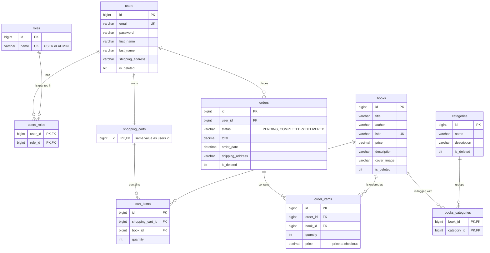

# BookService

**A REST API for an online bookstore: catalog, shopping carts and orders, with JWT security.**

An online bookstore needs more than a list of titles. Customers need to find books
quickly, collect them in a cart and check out. Staff need to keep the catalog up to
date and move orders through their life cycle, and none of that may leak to the wrong
user. BookService is the backend that does this. It is a Spring Boot 4 / Java 17
application that exposes a documented REST API:

- **customers** register, log in, browse and search the catalog, manage their cart,
  place orders and view their order history;
- **administrators** manage books and categories and update order statuses.

Data lives in MySQL, the schema is versioned with Liquibase, and the whole stack starts
with a single `docker compose` command.

## Table of contents

- [Features](#features)
- [Tech stack](#tech-stack)
- [Domain model](#domain-model)
- [API endpoints](#api-endpoints)
- [Getting started](#getting-started)
- [How to use](#how-to-use)
- [Testing](#testing)
- [Challenges and solutions](#challenges-and-solutions)
- [Demo](#demo)
- [Author](#author)

## Features

### Authentication and roles

- Registration with email, password confirmation (`password` / `repeatPassword` must
  match), first and last name, and an optional shipping address.
- Login returns a signed JWT (HS256, valid for 1 hour). Every other request is
  authenticated with `Authorization: Bearer <token>`.
- Two roles: `USER` (assigned automatically at registration) and `ADMIN`.
  Access is checked per endpoint with `@PreAuthorize`.
- Passwords are stored as BCrypt hashes. Registering an email that is already in use
  returns `409 Conflict`.

### Books

- Create, read, update and delete (`ADMIN` for write operations).
- Paginated and sortable listing (`page`, `size`, `sort`).
- Search by title and author (case-insensitive substring match) and by ISBN
  (case-insensitive exact match). Filters can be combined.
- Each book belongs to one or more categories.
- Soft delete: a deleted book keeps its database row but disappears from all queries.

### Categories

- Create, read, update and delete (`ADMIN` for write operations), with soft delete.
- Paginated listing and a paginated list of the books in a category.

### Shopping cart

- A cart is created automatically when a user registers.
- Add a book (adding the same book again increases its quantity), change an item's
  quantity, remove an item and view the cart.

### Orders

- Checkout turns the whole cart into an order with a shipping address. The cart is
  then emptied, and an empty cart cannot be checked out.
- Each order item stores the book price at the moment of checkout, and the order total
  is calculated from those prices.
- Paginated order history, plus the items of an order or a single item, limited to the
  current user's own orders.
- Administrators update order status: `PENDING`, `COMPLETED` or `DELIVERED`.

### Errors and validation

- Request bodies are validated with Jakarta Bean Validation. Validation errors return
  `400` with a JSON map of `field -> message`.
- Missing entities return `404`, a duplicate email returns `409` and bad credentials
  return `401`, each with a JSON `error` message.

## Tech stack

| Area | Technology |
| --- | --- |
| Language | Java 17 |
| Framework | Spring Boot 4.1 (Spring Web MVC, Spring Data JPA / Hibernate, Bean Validation) |
| Security | Spring Security (stateless, method security), JJWT 0.13, BCrypt |
| Database | MySQL 8.4 (`mysql-connector-j`) |
| Migrations | Liquibase (YAML changelogs) |
| Mapping | MapStruct 1.5 |
| Boilerplate | Lombok |
| API docs | springdoc-openapi 3 (Swagger UI with JWT bearer authorization) |
| Testing | JUnit 5, Mockito, Spring Boot Test, Spring Security Test, Testcontainers (MySQL) |
| Build and quality | Maven (Maven Wrapper), Checkstyle |
| Containers | Docker, Docker Compose |
| CI | GitHub Actions (`mvn verify` on every push and pull request) |

## Domain model

The schema below comes from the Liquibase changelogs in
`src/main/resources/db/changelog/changes`.



Notes:

- `shopping_carts.id` is both the primary key and a foreign key to `users.id`
  (`@MapsId`), so every user has exactly one cart.
- `cart_items` has a unique constraint on `(shopping_cart_id, book_id)`: one row per
  book per cart.
- `books`, `categories`, `users` and `orders` are soft-deleted through `is_deleted`.
- `decimal` columns are `DECIMAL(38, 2)`.

## API endpoints

All paths include the `/api` context path. "Public" means no token is required; every
other endpoint requires `Authorization: Bearer <token>` and the listed role.

**Pagination and sorting.** Endpoints marked *paged* accept the standard Spring Data
parameters `page` (zero-based), `size` and `sort` (for example `sort=price,desc`; repeat
`sort` to sort by several fields). They return a Spring `Page` JSON object
(`content`, `totalElements`, `totalPages`, ...).

**Search.** `GET /api/books/search` accepts the optional query parameters `title`,
`author` and `isbn` (each up to 255 characters). `title` and `author` match
case-insensitive substrings, `isbn` must match exactly (case-insensitive), and all
given filters must match. Search results are paged too.

### Authentication: `AuthenticationController`

| Method | Path | Role | Description |
| --- | --- | --- | --- |
| POST | `/api/auth/registration` | Public | Register a user (gets the `USER` role and an empty cart). Returns `201`. |
| POST | `/api/auth/login` | Public | Log in with email and password. Returns `{"token": "<JWT>"}`. |

### Books: `BookController`

| Method | Path | Role | Description |
| --- | --- | --- | --- |
| GET | `/api/books` | USER | List books (*paged*). |
| GET | `/api/books/search` | USER | Search by `title`, `author`, `isbn` (*paged*). |
| GET | `/api/books/{id}` | USER | Get a book with its category IDs. |
| POST | `/api/books` | ADMIN | Create a book. Returns `201`. |
| PUT | `/api/books/{id}` | ADMIN | Update a book. |
| DELETE | `/api/books/{id}` | ADMIN | Soft-delete a book. Returns `204`. |

### Categories: `CategoryController`

| Method | Path | Role | Description |
| --- | --- | --- | --- |
| GET | `/api/categories` | USER | List categories (*paged*). |
| GET | `/api/categories/{id}` | USER | Get a category. |
| GET | `/api/categories/{id}/books` | USER | List the books in a category, without category IDs (*paged*). |
| POST | `/api/categories` | ADMIN | Create a category. Returns `201`. |
| PUT | `/api/categories/{id}` | ADMIN | Update a category. |
| DELETE | `/api/categories/{id}` | ADMIN | Soft-delete a category. Returns `204`. |

### Shopping cart: `ShoppingCartController`

| Method | Path | Role | Description |
| --- | --- | --- | --- |
| GET | `/api/cart` | USER | Get the current user's cart. |
| POST | `/api/cart` | USER | Add a book: `{"bookId": 1, "quantity": 2}`. |
| PUT | `/api/cart/items/{cartItemId}` | USER | Set an item's quantity: `{"quantity": 3}`. |
| DELETE | `/api/cart/items/{cartItemId}` | USER | Remove an item. Returns `204`. |

### Orders: `OrderController`

| Method | Path | Role | Description |
| --- | --- | --- | --- |
| POST | `/api/orders` | USER | Place an order from the cart: `{"shippingAddress": "..."}`. Returns `201`. |
| GET | `/api/orders` | USER | The current user's order history, including items (*paged*). |
| GET | `/api/orders/{orderId}/items` | USER | Items of one of the user's orders (*paged*). |
| GET | `/api/orders/{orderId}/items/{itemId}` | USER | One item of one of the user's orders. |
| PATCH | `/api/orders/{id}` | ADMIN | Update an order's status: `{"status": "COMPLETED"}`. |

Example request bodies.

`POST /api/auth/registration`:

```json
{
  "email": "alice@example.com",
  "password": "S3cure-pass",
  "repeatPassword": "S3cure-pass",
  "firstName": "Alice",
  "lastName": "Reader",
  "shippingAddress": "221B Baker Street, London"
}
```

`POST /api/categories`:

```json
{ "name": "Fiction", "description": "Novels and short stories" }
```

`POST /api/books` (`categoryIds` must contain at least one existing category):

```json
{
  "title": "The Hobbit",
  "author": "J. R. R. Tolkien",
  "isbn": "978-0261103344",
  "price": 12.99,
  "description": "There and back again",
  "coverImage": "https://example.com/hobbit.jpg",
  "categoryIds": [1]
}
```

## Getting started

### Prerequisites

- Docker with the Docker Compose plugin, with the Docker daemon running.
  Java, Maven and MySQL are provided by the containers.
- To run the tests locally (optional): JDK 17. The Maven Wrapper is included.

### 1. Create the environment file

```bash
cp .env.template .env
```

Fill in the variables in `.env` (the two port variables are optional):

| Variable | Value to provide |
| --- | --- |
| `MYSQLDB_USER` | Application database user, for example `bookservice`. Do not use `root`. |
| `MYSQLDB_PASSWORD` | A strong, unique password for the application database user. |
| `MYSQLDB_ROOT_PASSWORD` | A separate strong password for the MySQL root user. |
| `MYSQLDB_DATABASE` | Database name, for example `book_service`. Use letters, digits and underscores. |
| `MYSQLDB_LOCAL_PORT` | Host port for MySQL. Defaults to `3306` if left empty; set another free port (for example `3307`) if a local MySQL already uses `3306`. |
| `SPRING_LOCAL_PORT` | Host port for the API. Defaults to `8088` if left empty; set another free port if `8088` is taken. |
| `JWT_SECRET` | A random signing secret of at least 32 ASCII characters. |

Run `openssl rand -hex 32` separately for each password and the JWT secret, then copy
each generated value into its corresponding variable. Single-quote values containing
`$` or `#` to preserve them literally.

`.env` is ignored by Git and excluded from the Docker build context. Keep credentials
only in this local file; the committed template must remain empty. Compose reads `.env`
automatically and reports an error if a required value is missing.

### 2. Build and start

```bash
docker compose up --build -d
```

The Dockerfile builds the JAR with the Maven Wrapper (tests are skipped in the image
build) and runs the application on Java 17 as an unprivileged user. Compose waits until
MySQL accepts an authenticated connection before starting the application, and
Liquibase then applies the database migrations. The first build downloads dependencies
and can take a few minutes.

### 3. Open the API

With the default `SPRING_LOCAL_PORT=8088` (replace `8088` with your chosen port):

| What | URL |
| --- | --- |
| API base URL | `http://localhost:8088/api` |
| Swagger UI | [http://localhost:8088/api/swagger-ui/index.html](http://localhost:8088/api/swagger-ui/index.html) |
| OpenAPI JSON | `http://localhost:8088/api/v3/api-docs` |

### Logs and shutdown

```bash
docker compose ps             # container status
docker compose logs -f app    # follow application logs
docker compose down           # stop and remove the containers (data is kept)
```

MySQL data remains in the `mysql-data` volume. Database names, users and passwords from
`.env` are applied only when MySQL initializes an empty volume; changing these values
later does not update an existing database or its credentials. To start from scratch,
remove the volume as well with `docker compose down -v` (this deletes all data).

The project uses `MYSQLDB_*` names in `.env`. Compose maps them to the `MYSQL_*`
variables required by the [official MySQL image](https://hub.docker.com/_/mysql).
The application connects to `mysql:3306` inside the Compose network; the local MySQL
port is exposed only on `127.0.0.1` for host tools. The JDBC settings disable TLS and
allow public key retrieval for this local Docker setup.

## How to use

### Authentication in Swagger UI

Swagger UI has an **Authorize** button (the `bearerAuth` JWT scheme):

1. Call **POST /auth/login** with your email and password and copy the `token` value
   from the response.
2. Click **Authorize** at the top of the page.
3. Paste the token **without** the `Bearer` prefix (Swagger UI adds it) and confirm.

Every request sent from Swagger UI now carries `Authorization: Bearer <token>`. When the
token expires (after one hour), log in again and re-authorize.

> HTTP Basic is also enabled. If you call a protected endpoint before authorizing, the
> browser may show its own Basic sign-in dialog. Authorize first to avoid it.

### Step by step

The examples use `http://localhost:8088/api`; replace the port with your
`SPRING_LOCAL_PORT`.

1. **Register.** In Swagger UI, open **Authentication → POST /auth/registration**, click
   *Try it out*, and send:

   ```json
   {
     "email": "alice@example.com",
     "password": "S3cure-pass",
     "repeatPassword": "S3cure-pass",
     "firstName": "Alice",
     "lastName": "Reader"
   }
   ```

   The user gets the `USER` role and an empty shopping cart.

2. **Log in.** Call **POST /auth/login** with the email and password. The response is
   `{"token": "<JWT>"}`. The token is valid for one hour.

   ```bash
   TOKEN=$(curl -s -X POST http://localhost:8088/api/auth/login \
     -H 'Content-Type: application/json' \
     -d '{"email":"alice@example.com","password":"S3cure-pass"}' \
     | python3 -c 'import sys, json; print(json.load(sys.stdin)["token"])')
   ```

3. **Authorize.** In Swagger UI, click **Authorize** and paste the token without the
   `Bearer` prefix (see [Authentication in Swagger UI](#authentication-in-swagger-ui)).
   With curl, add `-H "Authorization: Bearer $TOKEN"` to every request.

4. **Fill the catalog (admin).** A fresh database contains no books or categories, so an
   administrator first creates them (see [Admin access](#admin-access)):
   **POST /categories**, then **POST /books** with the new category ID in `categoryIds`.

5. **Browse and search.** **GET /books?page=0&size=10&sort=title,asc** lists the
   catalog. **GET /books/search?title=hobbit** searches it, and
   **GET /categories/{id}/books** lists a category.

   ```bash
   curl -s "http://localhost:8088/api/books/search?author=tolkien" \
     -H "Authorization: Bearer $TOKEN"
   ```

6. **Add a book to the cart.** **POST /cart** with `{"bookId": 1, "quantity": 2}`.
   **GET /cart** shows the cart and its item IDs, which you can use with
   **PUT /cart/items/{cartItemId}** and **DELETE /cart/items/{cartItemId}**.

7. **Place an order.** **POST /orders** with
   `{"shippingAddress": "221B Baker Street, London"}`. The order is created with status
   `PENDING`, item prices are captured from the books, and the cart is emptied.

8. **View the order history.** **GET /orders** returns your orders with their items.
   **GET /orders/{orderId}/items** and **GET /orders/{orderId}/items/{itemId}** return
   the items of one order.

### Admin access

Admin-only operations are creating, updating and deleting books and categories, and
updating order status (**PATCH /orders/{id}** with `{"status": "COMPLETED"}`).

The Liquibase changelog seeds an administrator, `admin@bookstore.com`, but only stores
its BCrypt hash; the password is not documented in this repository. Note that this
seeded account has **only** the `ADMIN` role, while the catalog `GET` endpoints, the cart
and orders require `USER`. An account with only `ADMIN` can manage the catalog and order
statuses but cannot browse or buy.

The practical way to get an administrator is to give an existing registered user the
`ADMIN` role. Run this from the project root while the stack is running, replacing
`user@example.com` with the user's email:

```bash
docker compose exec mysql sh -c 'mysql -u"$MYSQL_USER" -p"$MYSQL_PASSWORD" "$MYSQL_DATABASE" -e "INSERT INTO users_roles (user_id, role_id) SELECT u.id, r.id FROM users u CROSS JOIN roles r WHERE u.email = '\''user@example.com'\'' AND r.name = '\''ADMIN'\''"'
```

The database credentials are read from the MySQL container's own environment, so
nothing secret is typed on the command line. Then log in again with **POST /auth/login**,
authorize with the new token, and the user has both `USER` and `ADMIN`: they can manage
the catalog and order statuses as well as browse and shop (for example,
**POST /categories** now returns `201`). If the user already has the role, MySQL reports
`ERROR 1062 ... Duplicate entry`, which is harmless.

## Testing

```bash
./mvnw clean verify
```

Docker must be running: integration and repository tests start a throwaway MySQL 8.4
container with Testcontainers, and Liquibase applies the real migrations to it.
`verify` also runs Checkstyle on `src/main`. GitHub Actions runs the same `verify` build
on every push and pull request.

What is covered:

| Test class | Type | What it checks |
| --- | --- | --- |
| `BookControllerTest`, `CategoryControllerTest` | Full Spring Boot context over HTTP + MySQL | Pagination and sorting, search, `404` responses, validation errors, admin create / update / delete, `403` for `USER` on write endpoints, `401` for anonymous requests. |
| `BookRepositoryTest`, `CategoryRepositoryTest` | `@DataJpaTest` + MySQL | Search specifications (trimmed title / author, exact ISBN), books by category, soft delete keeps rows but hides them, deleted categories are hidden from a book. |
| `BookServiceImplTest`, `CategoryServiceImplTest` | Unit tests with Mockito | Mapping, pagination, category resolution, not-found handling, update and delete logic. |
| `BookServiceApplicationTests` | Spring Boot context | The application context starts. |

## Challenges and solutions

- **Soft delete without leaking deleted rows.** `Book`, `Category`, `User` and `Order`
  use Hibernate's `@SQLDelete` to turn `DELETE` into `UPDATE ... SET is_deleted = true`,
  and `@SQLRestriction("is_deleted = false")` to filter those rows out of every query,
  including relationships (a deleted category no longer appears on its books).
- **A cart that always exists.** Registration runs in one transaction that saves the
  user with the `USER` role and creates the cart. The cart shares the user's primary key
  (`@MapsId`), so it is looked up directly by user ID and there is exactly one cart per
  user.
- **Checkout that keeps history correct.** Placing an order copies each cart item into
  an order item, stores the book's current price on the order item, computes the total
  with `BigDecimal`, saves the order and empties the cart in a single transaction. Later
  price changes do not rewrite past orders.
- **Flexible search with JPA Specifications.** `BookSpecificationBuilder` builds the
  query only from the filters that were provided (trimmed, case-insensitive), so one
  endpoint handles any combination of title, author and ISBN while keeping pagination
  and sorting.
- **Stateless JWT security with role checks.** A `OncePerRequestFilter` validates the
  bearer token and loads the user. Sessions are stateless, `/auth/**` and the Swagger
  endpoints are public, and every controller method declares its role with
  `@PreAuthorize`. Order and cart endpoints always resolve data through the
  authenticated user's ID, so users cannot read each other's orders.
- **Email check that also sees deleted users.** Registration must reject an email that
  belongs to a soft-deleted user, otherwise the insert would hit the unique constraint on
  `@SQLRestriction`. It was first written as `SELECT EXISTS(...)` mapped to `boolean`, but
  MySQL returns that value as a number that Hibernate could not convert, so registration
  failed. It was replaced with a native `SELECT COUNT(*) ... WHERE email = :email`
  returning `long`, and the service checks `count > 0`. Soft-deleted users are still
  counted.
- **MySQL boolean column type mismatch.** The application runs with
  `spring.jpa.hibernate.ddl-auto=validate`, so Hibernate refuses to start if a column type
  differs from what it expects for the entity field. The `is_deleted` flags were created
  as generic `BOOLEAN` columns, while Hibernate maps a Java `boolean` to `BIT` on MySQL.
  Changeset 11 (`11-fix-boolean-column-types.yaml`) converts `is_deleted` in `books`,
  `users`, `categories` and `orders` to `BIT(1)`, so the schema and the entities agree.

## Demo

Video demo: <loom-url>

> The repository owner will replace `<loom-url>` with the link to the recorded
> walkthrough.

## Author

Author: Misanthrope88 (https://github.com/Misanthrope88)
